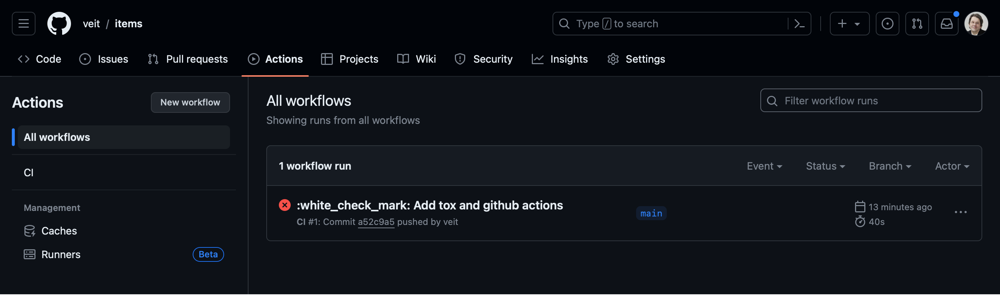
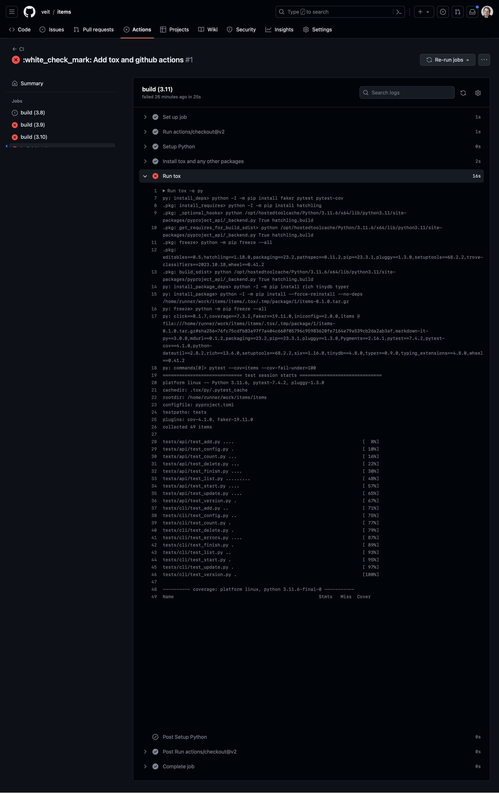

tox
===

`tox <https://tox.readthedocs.io/>`_ ist ein Automatisierungstool, das ähnlich
wie ein :term:`CI`-Tool funktioniert, jedoch sowohl lokal als auch in Verbindung
mit anderen CI-Tools auf einem Server ausgeführt werden kann.

Im Folgenden richten wir tox für unsere Tasks-Anwendung so ein, dass es uns beim
lokalen Testen unterstützt. Anschließend richten wir das Testen mithilfe von
GitHub Actions ein.

Einführung in tox
-----------------

tox ist ein Befehlszeilentool, mit dem ihr eure gesamte Testsuite in
verschiedenen Umgebungen ausführen könnt. Wir werden tox verwenden, um das
Tasks-Projekt in mehreren Python-Versionen zu testen, doch tox ist nicht nur auf
Python-Versionen beschränkt. Ihr könnt es nutzen, um Tests mit unterschiedlichen
Abhängigkeitskonfigurationen und unterschiedlichen Konfigurationen für
verschiedene Betriebssysteme durchzuführen. tox verwendet Projektinformationen
aus der Datei :file:`setup.py` oder :file:`pyproject.toml` des zu testenden
Pakets, um eine installierbare :doc:`Distribution eures Pakets
<../../packs/distribution>` zu erstellen. Es sucht im Abschnitt ``[tool.tox]``
der Datei :file:`pyproject.toml` nach einer Liste von Umgebungen und führt dann
für jede einzelne die folgenden Schritte aus:

#. erstellt eine :term:`virtuelle Umgebung`
#. installiert einige Abhängigkeiten mit :term:`pip`
#. erstellt euer Paket
#. installiert euer Paket mit pip
#. führt weitere Tests durch

Nachdem alle Umgebungen getestet wurden, gibt tox eine Zusammenfassung der
Ergebnisse aus.

Um diesen Prozess mit :term:`uv` zu beschleunigen, verwenden wir nicht direkt
tox, sondern `tox-uv <https://github.com/tox-dev/tox-uv>`_.

Einrichten von tox
------------------

Bisher wurde tox in der Regel in der Datei :file:`tox.ini` konfiguriert. Seit
tox 4.44.0 ist der Funktionsumfang jedoch eingefroren, und zukünftige
Konfigurationsparameter werden voraussichtlich nur noch in einer
:doc:`Python4DataScience:data-processing/serialisation-formats/toml/index`-Datei
bereitgestellt, beispielsweise in der Datei :ref:`pyproject-toml`. Sehen wir uns
eine einfache Konfiguration in der Datei :file:`pyproject.toml` an:

.. code-block:: toml

   [tool.tox]
   env_list = ["py315"]

   [tool.tox.env_run_base]
   dependency_groups = [ "tests" ]
   commands = [[ "pytest"]]

Im Abschnitt ``[tool.tox]`` haben wir ``env_list = ["py315"]`` definiert. Dies
ist eine Kurzschreibweise, die tox anweist, unsere Tests mit der Python-Version
3.15 auszuführen. Wir werden in Kürze weitere Python-Versionen hinzufügen, aber
die Verwendung einer einzigen Version hilft uns, die Funktionsweise von tox
besser zu verstehen.

Im Abschnitt ``[tool.tox.env_run_base]`` gibt ``dependency_groups`` ``tests``
an. Dadurch wird tox mitgeteilt, dass die entsprechenden Bibliotheken in dieser
Umgebung installiert werden sollen. Schließlich weist ``commands`` tox an,
``pytest`` auszuführen.

Die Konfiguration für eine bestimmte Umgebung kann über
:samp:`tool.tox.env.ENV_NAME` hinzugefügt werden, die Basiskonfiguration für
Pakete über :samp:`tool.tox.env_pkg_base`.

Ausführen von tox
-----------------

Bevor ihr tox ausführen könnt, müsst ihr sicherstellen, dass tox-uv installiert
ist:

.. tab:: Linux/macOS

   .. code-block:: console

      $ uv add --group tests tox-uv

.. tab:: Windows

   .. code-block:: ps1con

      C:> uv add --group tests tox-uv

Um tox auszuführen, startet tox einfach wie folgt:

.. code-block:: pytest

   $ uv run tox
   True: _optional_hooks> python /Users/veit/cusy/prj/cusy.tasks/.venv/lib/python3.15/site-packages/pyproject_api/_backend.py True uv_build
   True: get_requires_for_build_sdist> python /Users/veit/cusy/prj/cusy.tasks/.venv/lib/python3.15/site-packages/pyproject_api/_backend.py True uv_build
   True: build_sdist> python /Users/veit/cusy/prj/cusy.tasks/.venv/lib/python3.15/site-packages/pyproject_api/_backend.py True uv_build
   3.15: install_package> .venv/bin/uv pip install --reinstall --no-deps cusy-tasks@/Users/veit/cusy/prj/cusy.tasks/.tox/.tmp/package/9/cusy_tasks-26.2.0.tar.gz
   3.15: commands[0]> python --version --version
   Python 3.15.0 (main, Oct  9 2026, 11:16:41) [Clang 17.0.0 (clang-1700.6.4.2)]
   3.15: commands[1]> coverage run -m pytest ''
   ============================= test session starts ==============================
   platform darwin -- Python 3.15.0, pytest-9.2.0, pluggy-1.7.0
   cachedir: .tox/3.15/.pytest_cache
   rootdir: /Users/veit/cusy/prj/cusy.tasks
   configfile: pyproject.toml
   plugins: cov-7.1.0, Faker-40.44.0
   collected 83 items

   tests/api/test_add.py ......                                             [  7%]
   tests/api/test_config.py .                                               [  8%]
   tests/api/test_count.py ...                                              [ 12%]
   tests/api/test_delete.py ...                                             [ 15%]
   tests/api/test_delete_all.py ..                                          [ 18%]
   tests/api/test_exceptions.py ..                                          [ 20%]
   tests/api/test_finish.py ....                                            [ 25%]
   tests/api/test_item_id.py .                                              [ 26%]
   tests/api/test_list.py .........                                         [ 37%]
   tests/api/test_list_edge_cases.py ........                               [ 46%]
   tests/api/test_start.py ....                                             [ 51%]
   tests/api/test_task.py ...                                               [ 55%]
   tests/api/test_update.py .....                                           [ 61%]
   tests/api/test_version.py .                                              [ 62%]
   tests/cli/test_add.py ..                                                 [ 65%]
   tests/cli/test_config.py ..                                              [ 67%]
   tests/cli/test_count.py .                                                [ 68%]
   tests/cli/test_delete.py .                                               [ 69%]
   tests/cli/test_errors.py .......                                         [ 78%]
   tests/cli/test_finish.py .                                               [ 79%]
   tests/cli/test_help.py .........                                         [ 90%]
   tests/cli/test_list.py .....                                             [ 96%]
   tests/cli/test_start.py .                                                [ 97%]
   tests/cli/test_update.py .                                               [ 98%]
   tests/cli/test_version.py .                                              [100%]

   ============================== 83 passed in 0.21s ==============================
   True: _exit> python /Users/veit/cusy/prj/cusy.tasks/.venv/lib/python3.15/site-packages/pyproject_api/_backend.py True uv_build
     3.15: OK (0.76=setup[0.15]+cmd[0.01,0.60] seconds)
     congratulations :) (0.79 seconds)

Testen mehrerer Python-Versionen
--------------------------------

Dazu erweitern wir ``envlist`` in der Datei :file:`pyproject.toml`, um weitere
Python-Versionen hinzuzufügen:

.. code-block:: toml

   [tool.tox]
   env_list = [
     "3.15",
     "3.14",
     "3.13",
     "3.12",
     "3.11",
     "3.13t",
     "3.14t",
     "3.15t",
   ]
   skip_missing_interpreters = true

Wir werden nun die Python-Versionen von 3.11 bis 3.15 testen. Zudem haben wir
die Einstellung ``skip_missing_interpreters = true`` hinzugefügt, damit tox
nicht fehlschlägt, falls eine der aufgeführten Python-Versionen auf eurem System
fehlt. Ist der Wert auf ``true`` gesetzt, führt tox die Tests mit jeder
verfügbaren Python-Version durch, überspringt jedoch die nicht gefundenen
Versionen, ohne dass es zu einem Fehler kommt. Die Ausgabe ist sehr ähnlich,
allerdings werde ich im folgenden nur die Unterschiede hervorheben:

.. code-block:: pytest
   :emphasize-lines: 3-6, 10-14, 18-22, 26-30, 34-38, 42-46, 50-54, 58-62, 67-

    $ uv run tox
    ...
    3.15: install_package> .venv/bin/uv pip install --reinstall --no-deps cusy-tasks@/Users/veit/cusy/prj/cusy.tasks/.tox/.tmp/package/18/cusy_tasks-26.2.0.tar.gz
    3.15: commands[0]> python --version --version
    Python 3.15.0 (main, Oct  9 2026, 11:16:41) [Clang 17.0.0 (clang-1700.6.4.2)]
    3.15: commands[1]> coverage run -m pytest ''
    ============================= test session starts ==============================
    ...
    ============================== 83 passed in 0.22s ==============================
    3.15: OK ✔ in 0.77 seconds
    3.14: install_package> .venv/bin/uv pip install --reinstall --no-deps cusy-tasks@/Users/veit/cusy/prj/cusy.tasks/.tox/.tmp/package/19/cusy_tasks-26.2.0.tar.gz
    3.14: commands[0]> python --version --version
    Python 3.14.9 (main, Oct 21 2026, 17:47:42) [Clang 23.1.3 ]
    3.14: commands[1]> coverage run -m pytest ''
    ============================= test session starts ==============================
    ...
    ============================== 83 passed in 0.24s ==============================
    3.14: OK ✔ in 0.68 seconds
    3.13: install_package> .venv/bin/uv pip install --reinstall --no-deps cusy-tasks@/Users/veit/cusy/prj/cusy.tasks/.tox/.tmp/package/20/cusy_tasks-26.2.0.tar.gz
    3.13: commands[0]> python --version --version
    Python 3.13.16 (main, Sep 30 2026, 18:57:20) [Clang 17.0.0 (clang-1700.6.4.2)]
    3.13: commands[1]> coverage run -m pytest ''
    ============================= test session starts ==============================
    ...
    ============================== 83 passed in 0.34s ==============================
    3.13: OK ✔ in 0.84 seconds
    3.12: install_package> .venv/bin/uv pip install --reinstall --no-deps cusy-tasks@/Users/veit/cusy/prj/cusy.tasks/.tox/.tmp/package/21/cusy_tasks-26.2.0.tar.gz
    3.12: commands[0]> python --version --version
    Python 3.12.6 (v3.12.6:a4a2d2b0d85, Sep  6 2024, 16:08:03) [Clang 13.0.0 (clang-1300.0.29.30)]
    3.12: commands[1]> coverage run -m pytest ''
    ============================= test session starts ==============================
    ...
    ============================== 83 passed in 0.72s ==============================
    3.12: OK ✔ in 1.33 seconds
    3.11: install_package> .venv/bin/uv pip install --reinstall --no-deps cusy-tasks@/Users/veit/cusy/prj/cusy.tasks/.tox/.tmp/package/22/cusy_tasks-26.2.0.tar.gz
    3.11: commands[0]> python --version --version
    Python 3.11.17 (main, Oct 21 2026, 17:46:23) [Clang 23.1.3 ]
    3.11: commands[1]> coverage run -m pytest ''
    ============================= test session starts ==============================
    ...
    ============================== 83 passed in 0.31s ==============================
    3.11: OK ✔ in 0.71 seconds
    3.13t: install_package> .venv/bin/uv pip install --reinstall --no-deps cusy-tasks@/Users/veit/cusy/prj/cusy.tasks/.tox/.tmp/package/23/cusy_tasks-26.2.0.tar.gz
    3.13t: commands[0]> python --version --version
    Python 3.13.0 experimental free-threading build (main, Oct 16 2024, 08:24:33) [Clang 18.1.8 ]
    3.13t: commands[1]> coverage run -m pytest ''
    ============================= test session starts ==============================
    ...
    ============================== 83 passed in 0.85s ==============================
    3.13t: OK ✔ in 1.56 seconds
    3.14t: install_package> .venv/bin/uv pip install --reinstall --no-deps cusy-tasks@/Users/veit/cusy/prj/cusy.tasks/.tox/.tmp/package/24/cusy_tasks-26.2.0.tar.gz
    3.14t: commands[0]> python --version --version
    Python 3.14.0b4 free-threading build (main, Jul  8 2025, 21:06:49) [Clang 20.1.4 ]
    3.14t: commands[1]> coverage run -m pytest ''
    ============================= test session starts ==============================
    ...
    ============================== 83 passed in 0.25s ==============================
    3.14t: OK ✔ in 0.69 seconds
    3.15t: install_package> .venv/bin/uv pip install --reinstall --no-deps cusy-tasks@/Users/veit/cusy/prj/cusy.tasks/.tox/.tmp/package/25/cusy_tasks-26.2.0.tar.gz
    3.15t: commands[0]> python --version --version
    Python 3.15.0 free-threading build (main, Oct  9 2026, 15:11:36) [Clang 22.1.3 ]
    3.15t: commands[1]> coverage run -m pytest ''
    ============================= test session starts ==============================
    ...
    ============================== 83 passed in 0.21s ==============================
    True: _exit> python /Users/veit/cusy/prj/cusy.tasks/.venv/lib/python3.15/site-packages/pyproject_api/_backend.py True uv_build
      3.15: OK (0.76=setup[0.15]+cmd[0.01,0.60] seconds)
      3.14: OK (0.68=setup[0.07]+cmd[0.01,0.60] seconds)
      3.13: OK (0.84=setup[0.09]+cmd[0.01,0.75] seconds)
      3.12: OK (1.33=setup[0.08]+cmd[0.02,1.23] seconds)
      3.11: OK (0.71=setup[0.07]+cmd[0.01,0.63] seconds)
      3.13t: OK (1.56=setup[0.07]+cmd[0.01,1.47] seconds)
      3.14t: OK (0.69=setup[0.07]+cmd[0.01,0.61] seconds)
      3.15t: OK (0.68=setup[0.08]+cmd[0.01,0.59] seconds)
      congratulations :) (7.28 seconds)

Parallele Ausführung von Tox-Umgebungen
---------------------------------------

Im vorherigen Beispiel wurden die verschiedenen Umgebungen nacheinander
ausgeführt. Mit der Option ``-p`` ist es auch möglich, sie parallel auszuführen:

.. code-block:: pytest

   $ uv run tox -p
   warning: Malware checks are experimental and may change without warning. Pass `--preview-features malware-check` to disable this warning.
   3.15t: OK ✔ in 1.01 seconds
   3.14t: OK ✔ in 1.08 seconds
   3.14: OK ✔ in 1.29 seconds
   3.15: OK ✔ in 1.31 seconds
   3.11: OK ✔ in 1.36 seconds
   3.13: OK ✔ in 1.43 seconds
   3.12: OK ✔ in 1.85 seconds
     3.15: OK (1.31=setup[0.26]+cmd[0.02,1.03] seconds)
     3.14: OK (1.29=setup[0.27]+cmd[0.01,1.01] seconds)
     3.13: OK (1.43=setup[0.29]+cmd[0.02,1.13] seconds)
     3.12: OK (1.85=setup[0.25]+cmd[0.02,1.58] seconds)
     3.11: OK (1.36=setup[0.28]+cmd[0.02,1.06] seconds)
     3.13t: OK (2.19=setup[0.27]+cmd[0.01,1.91] seconds)
     3.14t: OK (1.08=setup[0.22]+cmd[0.01,0.84] seconds)
     3.15t: OK (1.01=setup[0.19]+cmd[0.01,0.81] seconds)
     congratulations :) (2.23 seconds)

.. note::
   Die Ausgabe ist nicht gekürzt; dies ist die vollständige Ausgabe, die ihr
   sehen werdet, wenn alles funktioniert.

Coverage-Bericht in tox hinzufügen
----------------------------------

Die Konfiguration von Coverage-Berichten lässt sich ganz einfach in die Datei
:file:`pyproject.toml` einfügen. Dazu müssen wir ``pytest-cov`` zur
Abhängigkeitsgruppe ``tests`` hinzufügen, damit das ``pytest-cov``-Plugin auch
in den tox-Testumgebungen installiert wird. Durch die Einbindung von
``pytest-cov`` werden auch alle anderen Abhängigkeiten, wie beispielsweise
``coverage``, mit einbezogen. Anschließend fügen wir
:samp:`env.coverage-report.{OPTIONS}` hinzu und ändern
``env_run_base.commands``:

.. code-block:: toml
   :emphasize-lines: 6, 16-23, 26-

   [dependency-groups]
   ...
   tests = [
     "faker",
     "pytest>=6",
     "pytest-cov",
   ]

   [tool.tox]
   requires = [ "tox>=4" ]
   env_list = [
     "py3{10-14}",
     "py{13-14}t",
   ]
   skip_missing_interpreters = true
   env.coverage-report.description = "Report coverage over all test runs."
   env.coverage-report.deps = [ "coverage[toml]" ]
   env.coverage-report.depends = [ "py" ]
   env.coverage-report.skip_install = true
   env.coverage-report.commands = [
     [ "coverage combine" ],
     [ "coverage report" ],
   ]
   env_run_base.dependency_groups = [ "tests" ]
   env_run_base.deps = [ "coverage[toml]" ]
   env_run_base.commands = [
     [ "coverage", "run", "-m", "pytest" ],
   ]

Wenn ihr Coverage zusammen mit ``tox`` verwendet, kann es manchmal hilfreich
sein, einen Abschnitt in die Datei :file:`pyproject.toml` einzufügen, um
Coverage mitzuteilen, welche Quellcode-Pfade als identisch betrachtet werden
sollen:

.. code-block:: toml

   [tool.coverage.paths]
   source = ["src", ".tox/py*/**/site-packages"]

Der Quellcode von Tasks befindet sich zunächst im Verzeichnis
:file:`src/cusy/tasks/`, bevor tox die virtuellen Umgebungen erstellt und Tasks
in der Umgebung installiert. Anschließend befindet er sich beispielsweise unter
:file:`.tox/py315/lib/python3.15/site-packages/cusy.tasks`.

.. code-block:: console
   :emphasize-lines: 1

   $ uv run tox
   ...
   coverage-report: commands[1]> coverage report
   Name    Stmts   Miss Branch BrPart  Cover   Missing
   ---------------------------------------------------
   TOTAL     365      0     14      0   100%

   29 files skipped due to complete coverage.
     3.15: OK (0.82=setup[0.15]+cmd[0.01,0.65] seconds)
     3.14: OK (0.78=setup[0.07]+cmd[0.01,0.70] seconds)
     3.13: OK (0.92=setup[0.09]+cmd[0.01,0.82] seconds)
     3.12: OK (1.35=setup[0.08]+cmd[0.01,1.26] seconds)
     3.11: OK (0.77=setup[0.08]+cmd[0.01,0.69] seconds)
     3.13t: OK (1.64=setup[0.08]+cmd[0.01,1.55] seconds)
     3.14t: OK (0.82=setup[0.09]+cmd[0.01,0.72] seconds)
     3.15t: OK (0.74=setup[0.08]+cmd[0.01,0.66] seconds)
     coverage-report: OK (0.19=setup[0.00]+cmd[0.09,0.10] seconds)
     congratulations :) (8.07 seconds)

Mindestabdeckung festlegen
--------------------------

Bei der Durchführung einer Abdeckungsanalyse mit tox ist es sinnvoll, einen
Mindestwert für die Abdeckung festzulegen, um eventuelle Abdeckungslücken zu
erkennen. Dies geschieht mit der Option ``--cov-fail-under``:

.. code-block:: console
   :emphasize-lines: 8

   Name               Stmts   Miss Branch BrPart  Cover   Missing
   --------------------------------------------------------------
   src/cusy/tasks/api.py 68      1     12      1    98%   88
   --------------------------------------------------------------
   TOTAL                428      1     32      1    99%

   26 files skipped due to complete coverage.
   Coverage failure: total of 99 is less than fail-under=100

Dadurch wird die markierte Zeile zur Ausgabe hinzugefügt.

.. _posargs:

Weitergabe von pytest-Parametern an tox
---------------------------------------

Wir können auch einzelne Tests mit tox aufrufen, indem wir eine weitere Änderung
vornehmen, sodass :term:`parameters <Parameter>` an pytest übergeben werden
können:

.. code-block:: toml
   :emphasize-lines: 19

   [tool.tox]
   requires = [ "tox>=4" ]
   env_list = [
     "3.15",
     "3.14",
     "3.13",
     "3.12",
     "3.11",
     "3.13t",
     "3.14t",
     "3.15t",
     "coverage-report",
   ]
   skip_missing_interpreters = true
   env_run_base.dependency_groups = [ "tests" ]
   env_run_base.deps = [ "coverage[toml]" ]
   env_run_base.commands = [
     [ "python", "--version", "--version" ],
     [ "coverage", "run", "-m", "pytest", "{posargs}" ],
   ]

Um Argumente an pytest zu übergeben, fügt diese zwischen den tox-Argumenten und
den pytest-Argumenten ein. In diesem Fall wählen wir mit der Schlüsselwortoption
``-k`` Tests der Version ``test_version`` aus. Außerdem verwenden wir
``--no-cov``, um die Codeabdeckung zu deaktivieren:

.. code-block:: pytest
   :emphasize-lines: 1, 7

   $ uv run tox -e py315 -- -k test_version --no-cov
   ...
   py315: recreate env because requirements removed: coverage[toml]
   py315: remove tox env folder /Users/veit/cusy/prj/cusy.tasks/.tox/py315
   py315: venv> .venv/bin/uv venv -p cpython3.15 --allow-existing '--prompt=cusy.tasks[py315]' --python-preference system /Users/veit/cusy/prj/cusy.tasks/.tox/py315
   py315: install_dependency-groups> .venv/bin/uv pip install 'coverage[toml]' faker pytest-cov 'pytest>=9'
   True: _optional_hooks> python /Users/veit/cusy/prj/cusy.tasks/.venv/lib/python3.15/site-packages/pyproject_api/_backend.py True uv_build
   True: get_requires_for_build_sdist> python /Users/veit/cusy/prj/cusy.tasks/.venv/lib/python3.15/site-packages/pyproject_api/_backend.py True uv_build
   True: build_sdist> python /Users/veit/cusy/prj/cusy.tasks/.venv/lib/python3.15/site-packages/pyproject_api/_backend.py True uv_build
   py315: install_package_deps> .venv/bin/uv pip install rich 'tinydb<4.9' typer
   py315: install_package> .venv/bin/uv pip install --reinstall --no-deps cusy-tasks@/Users/veit/cusy/prj/cusy.tasks/.tox/.tmp/package/5/cusy_tasks-26.2.0.tar.gz
   py315: commands[0]> python --version --version
   Python 3.15.0 (main, Oct  9 2026, 11:16:41) [Clang 17.0.0 (clang-1700.6.4.2)]
   True: _exit> python /Users/veit/cusy/prj/cusy.tasks/.venv/lib/python3.15/site-packages/pyproject_api/_backend.py True uv_build
     py315: OK (0.58=setup[0.57]+cmd[0.01] seconds)
     congratulations :) (0.61 seconds)

      py314: commands[0]> coverage run -m pytest -k test_version --no-cov
      ============================= test session starts ==============================
      platform darwin -- Python 3.14.0, pytest-8.3.3, pluggy-1.5.0
      cachedir: .tox/py314/.pytest_cache
      rootdir: /Users/veit/cusy/prj/cusy.tasks
      configfile: pyproject.toml
      testpaths: tests
      plugins: cov-5.0.0, anyio-4.6.0, Faker-30.3.0
      collected 49 items / 47 deselected / 2 selected

      tests/api/test_version.py .                                              [ 50%]
      tests/cli/test_version.py .                                              [100%]

      ======================= 2 passed, 47 deselected in 0.07s =======================
      .pkg: _exit> python /Users/veit/cusy/prj/cusy.tasks/.venv/lib/python3.14/site-packages/pyproject_api/_backend.py True hatchling.build
        py314: OK (1.49=setup[0.96]+cmd[0.53] seconds)
        congratulations :) (1.53 seconds)

``tox`` eignet sich nicht nur ideal für die lokale Automatisierung von
Testprozessen, sondern unterstützt auch serverbasierte :term:`CI`. Fahren wir
nun mit der Ausführung von pytest und tox mithilfe von GitHub Actions fort.

Ausführung von ``tox`` mit GitHub Actions
-----------------------------------------

Wenn euer Projekt auf `GitHub <https://github.com/>`_ gehostet wird, könnt ihr
GitHub Actions nutzen, um eure Tests automatisch in verschiedenen Umgebungen
auszuführen. Für GitHub Actions steht eine ganze Reihe von Umgebungen zur
Verfügung: `github.com/actions/virtual-environments
<https://github.com/actions/runner-images?tab=readme-ov-file>`_.

#. Um eine GitHub-Action in eurem Projekt zu erstellen, klickt auf
   :menuselection:`Actions --> set up a workflow yourself`. Dadurch wird in der
   Regel eine Datei namens :file:`.github/workflows/main.yml` erstellt.
#. Gebt dieser Datei einen aussagekräftigeren Namen. Wir verwenden hierfür
   üblicherweise :file:`ci.yml`.
#. Die vorbelegte YAML-Datei ist für unsere Zwecke nicht besonders hilfreich.
   Ihr könnt einen Abschnitt zur Testabdeckung hinzufügen, :abbr:`z. B. (zum
   Beispiel)` mit:

   .. code-block:: yaml

      jobs:
        coverage:
          name: Ensure 100% test coverage
          runs-on: ubuntu-latest
          needs: tests
          if: always()

          steps:
            - uses: actions/checkout@de0fac2e4500dabe0009e67214ff5f5447ce83dd # v6.0.2
              with:
                persist-credentials: false
            - uses: actions/setup-python@a309ff8b426b58ec0e2a45f0f869d46889d02405 # v6.2.0
              with:
                python-version-file: .python-version
            - uses: hynek/setup-cached-uv@4300ec2180bc77d705e626a34e381b81a4772c51 # v2.5.0

            - name: Download coverage data
              uses: actions/download-artifact@3e5f45b2cfb9172054b4087a40e8e0b5a5461e7c # v8.0.1
              with:
                pattern: coverage-data-*
                merge-multiple: true

            - name: Combine coverage and fail if it’s <100%.
              run: |
                uv tool install coverage

                coverage combine
                coverage html --skip-covered --skip-empty

                # Report and write to summary.
                coverage report --format=markdown >> $GITHUB_STEP_SUMMARY

                # Report again and fail if under 100%.
                coverage report --fail-under=100

   ``name``
       kann ein beliebiger Name sein. Er wird in der Benutzeroberfläche von
       GitHub Actions angezeigt.
   ``steps``
       ist eine Liste von Schritten. Der Name jedes Schritts kann beliebig
       gewählt werden und ist optional.
   ``uses: actions/checkout``
       ist ein GitHub-Actions-Tool, das unser Repository auscheckt, damit der
       Rest des Workflows darauf zugreifen kann.
   ``uses: actions/setup-python``
       ist ein GitHub-Actions-Tool, das Python konfiguriert und in einer
       Build-Umgebung installiert.
   ``with: python-version: ${{ matrix.python }}``
       legt fest, dass für jede der in ``matrix.python`` aufgeführten
       Python-Versionen eine Umgebung erstellt werden soll.
   ``uses: hynek/setup-cached-uv``
       verwendet :term:`uv` in GitHub Actions.

       .. seealso::
          * `setup-cached-uv <https://github.com/hynek/setup-cached-uv>`_

#. Anschließend könnt ihr auf :guilabel:`Start commit` klicken. Da wir vor der
   automatischen Ausführung der Tests noch weitere Änderungen vornehmen möchten,
   wählen wir :guilabel:`Create a new branch for this commit and start a pull
   request` und geben *github-actions* als Namen für den neuen Branch ein. Zum
   Schluss könnt ihr auf :guilabel:`Create pull request` klicken.
#. Um zum neuen Branch zu wechseln, gehen wir zu :menuselection:`Code --> main
   --> github-actions`.

Die Actions-Syntax ist gut dokumentiert. Ein guter Einstieg in die
GitHub-Actions-Dokumentation ist die Seite `Building and Testing Python
<https://docs.github.com/en/actions/use-cases-and-examples/building-and-testing/building-and-testing-python>`__.
Die Dokumentation zeigt euch auch, wie ihr pytest direkt ohne tox ausführen und
wie ihr die Matrix auf mehrere Betriebssysteme erweitern könnt. Sobald ihr eure
:file:`*.yml`-Datei eingerichtet und in euer GitHub-Repository hochgeladen habt,
wird sie automatisch ausgeführt. Die Ausführungsläufe können Sie dann auf der
Registerkarte :menuselection:`Actions` einsehen:

Die verschiedenen Python-Umgebungen sind auf der linken Seite aufgelistet. Wenn
ihr eine davon auswählt, werden die Ergebnisse für diese Umgebung angezeigt, wie
im folgenden Screenshot zu sehen ist:

.. seealso::
   * `Building and testing Python
     <https://docs.github.com/en/actions/use-cases-and-examples/building-and-testing/building-and-testing-python>`__
   * `Workflow syntax for GitHub Actions
     <https://docs.github.com/en/actions/writing-workflows/workflow-syntax-for-github-actions>`_

Badge anzeigen
--------------

Jetzt könnt ihr eurer :file:`README.rst`-Datei ein Badge mit eurem
:term:`CI`-Status hinzufügen, :abbr:`z. B. (zum Beispiel)` mit:

.. code-block:: rest

   .. image:: https://github.com/YOU/YOUR_PROJECT/workflows/CI/badge.svg?branch=main
      :target: https://github.com/YOU/YOUR_PROJECT/actions?workflow=CI
      :alt: CI Status

Testabdeckung veröffentlichen
-----------------------------

Ihr könnt die Testabdeckung auf GitHub veröffentlichen, :abbr:`s. a. (siehe
auch)` :ref:`Coverage GitHub-Actions <coverage-github-actions>`.

tox erweitern
-------------

tox nutzt `pluggy <https://pluggy.readthedocs.io/en/stable/>`_, um das
Standardverhalten anzupassen. Pluggy findet ein Plugin, indem es nach einem
Einstiegspunkt mit dem Namen ``tox`` sucht, beispielsweise in einer
:file:`pyproject.toml`-Datei:

.. code-block:: toml

   [project.entry-points.tox]
   my_plugin = "my_plugin.hooks"

Um das Plugin zu nutzen, muss es daher lediglich in derselben Umgebung
installiert werden, in der tox läuft, und es wird über den definierten
Einstiegspunkt gefunden.

Ein Plugin wird durch die Implementierung von Erweiterungspunkten in Form von
Hooks erstellt. Der folgende Codeausschnitt würde beispielsweise eine neue
``--my``-:abbr:`CLI (Command Line Interface)` definieren:

.. code-block:: python

   from tox.config.cli.parser import ToxParser
   from tox.plugin import impl

   @impl
   def tox_add_option(parser: ToxParser) -> None:
       parser.add_argument("--my", action="store_true", help="my option")

.. seealso::
   * `Extending tox <https://tox.wiki/en/latest/plugins.html>`_
   * `tox development team <https://github.com/orgs/tox-dev/repositories>`_

.. _tox_uv:

``tox-uv``
----------

`tox-uv <https://pypi.org/project/tox-uv/>`_ ist ein Tox-Plugin, das :term:`virtualenv` und :term:`pip` in eurem Tox-Umgebungen durch :term:`uv` ersetzt.

Ihr könnt ``tox`` und ``tox-uv`` wie folgt installieren:

.. code-block:: console

   $ uv tool install tox --with tox-uv

:file:`uv.lock`-Unterstützung
~~~~~~~~~~~~~~~~~~~~~~~~~~~~~

Wenn ihr  ``uv sync`` mit einer :file:`uv.lock`-Datei für eine Tox-Umgebung
verwenden möchtet, müsst ihr den Runner für diese Tox-Umgebung auf
``uv-venv-lock-runner`` ändern, :abbr:`z. B. (zum Beispiel)`:

.. code-block:: toml
   :caption: pyproject.toml

   env.app.dependency_groups = [ "tests" ]
   env.app.runner = "uv-venv-lock-runner"
   commands = [[ "pytest"]]

Die ``app``-Umgebung nutzt den ``uv-venv-lock-runner`` und verwendet den Befehl
``uv sync --locked``, um die Abhängigkeiten in den in der Datei :file:`uv.lock`
angegebenen Versionen zu installieren.

.. seealso::
   * `uv.lock support
     <https://github.com/tox-dev/tox-uv?tab=readme-ov-file#uvlock-support>`_
